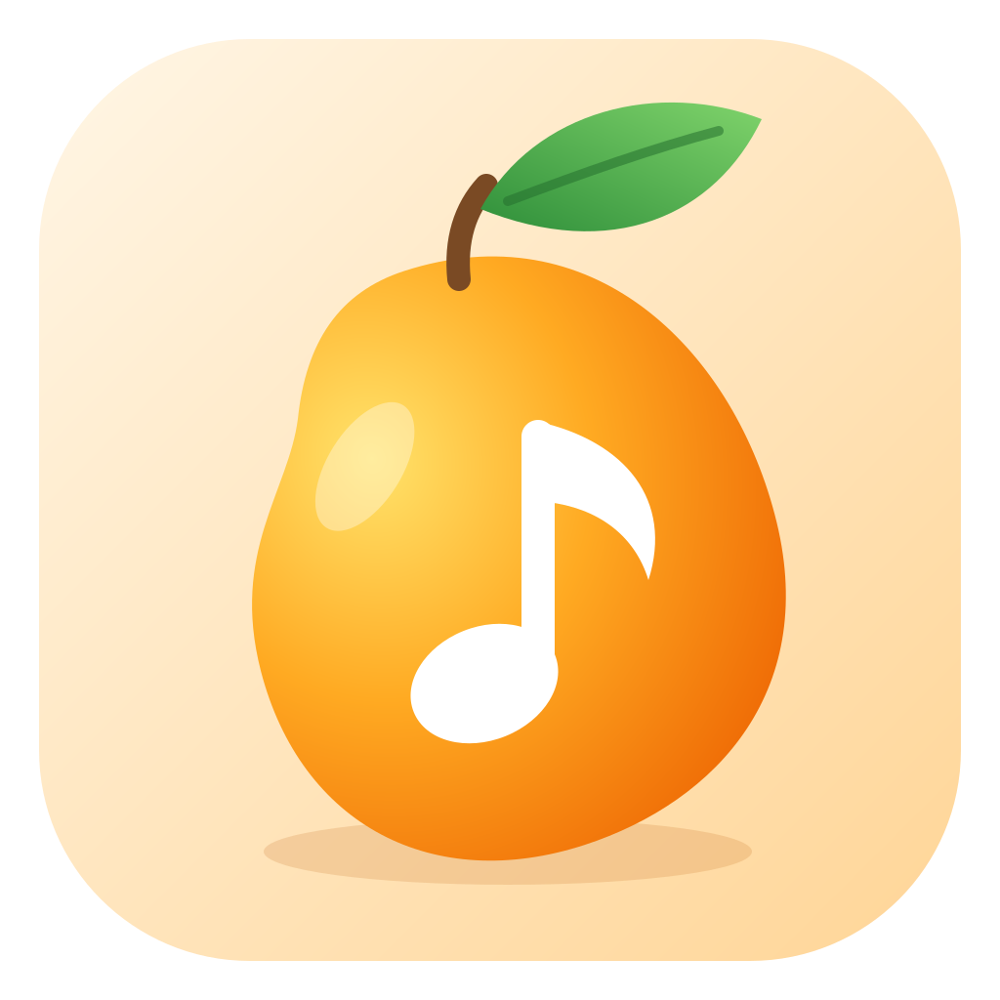

<p align="center"></p>

# Melomango

Reproductor de música en streaming gratuito para escritorio, hecho con **Tauri v2 + React + TypeScript + Rust**.
Sin pagar ni un mango.

Playlists, Me gusta, letras sincronizadas (LRCLIB), importación de playlists de Spotify y fuentes ampliables con plugins.

Fuentes:

- **Audius** (integrada): plataforma descentralizada con API abierta y canciones completas, legal y gratis.
- **YouTube** (plugin instalable desde la app): todo el catálogo de YouTube, vía [yt-dlp](https://github.com/yt-dlp/yt-dlp).
- Cualquier otra que alguien escriba como plugin: ver [plugins/PROTOCOL.md](plugins/PROTOCOL.md).

Los plugins oficiales viven en [fergaschas/melomango-plugins](https://github.com/fergaschas/melomango-plugins).

## Instalar

Descarga el instalador de la página de [Releases](https://github.com/fergaschas/melomango/releases):

- **`Melomango_<versión>_x64-setup.exe`** (recomendado): se instala para tu usuario, sin pedir permisos de administrador.
- **`Melomango_<versión>_x64_es-ES.msi`**: para instalaciones gestionadas o para todos los usuarios.

Windows SmartScreen puede avisar de que la app no está firmada: pulsa *Más información → Ejecutar de todas formas*.

## Actualizaciones automáticas

Desde la versión 0.2.0, Melomango busca actualizaciones al arrancar (y con **Buscar actualizaciones**, abajo en la
barra lateral). Si hay una versión nueva, ofrece instalarla: la descarga, comprueba su **firma** y se reinicia.

Lee `latest.json` de la última release de GitHub. Solo acepta paquetes firmados con la clave privada del proyecto
(la clave pública está en `src-tauri/tauri.conf.json`).

> Quien tenga la 0.1.0 debe instalar la 0.2.0 a mano una vez: esa versión todavía no traía el actualizador.

## Publicar una versión

1. Sube el número de versión en `package.json`, `src-tauri/Cargo.toml` y `src-tauri/tauri.conf.json` (los tres iguales).
2. Haz commit y push.
3. Publica:

   ```powershell
   npm run release -- --publish --notes "Qué hay de nuevo"
   ```

El script compila los instaladores firmados, genera `latest.json` y crea la release `v<versión>` con todo.
Sin `--publish` solo compila (los archivos quedan en `src-tauri/target/release/bundle/`).

**Clave de firma:** `~/.tauri/melomango.key` (o la variable `TAURI_SIGNING_PRIVATE_KEY`). Guárdala con copia de
seguridad y no la subas nunca al repo: sin ella no se pueden publicar actualizaciones para quien ya tiene la app.

El icono sale de [`app-icon.svg`](app-icon.svg): si lo cambias, regenera todos los tamaños con `npx tauri icon app-icon.svg`.

## Desarrollo

```powershell
npm install
npm run tauri dev
```

Tests:

```powershell
cd src-tauri; cargo test                     # unitarios
cd src-tauri; cargo test -- --include-ignored # + pruebas reales: Audius, y descarga e instalación del plugin de YouTube
```

## Plugins

Un plugin es una carpeta con `plugin.json` y un ejecutable que habla un protocolo JSON muy simple
(`search`, `trending`, `stream`). Se puede escribir en cualquier lenguaje: [plugins/PROTOCOL.md](plugins/PROTOCOL.md).

### Buscar e instalar plugins

**Plugins → Explorar** muestra los plugins de los repositorios configurados, con buscador. Al pulsar **Instalar**,
la app descarga el zip, comprueba su SHA-256 y lo instala. Sin reiniciar, aparece una pestaña nueva junto a Audius.

- El repositorio oficial viene configurado. Puedes añadir otros (cualquier `index.json` servido por HTTPS) en
  **Explorar → Repositorios**. El formato está en [plugins/PROTOCOL.md](plugins/PROTOCOL.md).
- Para probar un plugin en desarrollo: **Instalados → Instalar desde carpeta…**

### Spotify (importar playlists)

El plugin **Spotify** importa tus playlists, tus «Canciones que te gustan» y tus álbumes guardados. Solo lee
metadatos: al reproducir, Melomango busca cada canción en YouTube (por artista, título y duración) y recuerda el
resultado, así que conviene tener también el plugin de YouTube.

1. **Plugins → Explorar**, busca «spotify» e instálalo.
2. En la barra lateral, junto a *Playlists*, pulsa **⬇ Importar playlists → Conectar Spotify**.
3. Se abre el navegador: la primera vez te guía para crear tu propia app gratuita en
   [developer.spotify.com](https://developer.spotify.com/dashboard) (Redirect URI `http://127.0.0.1:43821/callback`)
   y pegar su *Client ID*. Después inicias sesión en Spotify.
4. Elige qué importar. Las playlists importadas tienen un botón **Sincronizar** para traer los cambios.

Limitaciones de Spotify: solo deja leer las playlists que has creado o en las que colaboras (no las que solo
sigues ni las editoriales como «Éxitos de hoy»).

### YouTube

En Melomango: **Plugins → Explorar**, busca «youtube» y pulsa **Instalar**. El plugin necesita
[yt-dlp](https://github.com/yt-dlp/yt-dlp): si no lo tienes, Melomango lo instala a continuación con `winget`
(en *Instalados* verás «Necesita: yt-dlp ✓»). Sin winget, instálalo a mano o deja `yt-dlp.exe` en la carpeta del plugin.

Si YouTube cambia algo y deja de funcionar, actualiza yt-dlp: `yt-dlp -U` (o `winget upgrade yt-dlp.yt-dlp`).

> ⚖️ Reproducir YouTube fuera de su reproductor va contra sus Términos de Servicio. Por eso es un plugin
> opcional e independiente de la app: úsalo para uso personal y bajo tu responsabilidad.

## Arquitectura

```
src/                          Frontend (React)
  lib/api.ts                  invoke() a Rust + URL del protocolo stream://
  hooks/usePlayer.ts          cola, <audio>, Media Session (teclas multimedia / SMTC)
  components/                 TrackList, PlayerBar, PluginsDialog, iconos
src-tauri/src/
  lib.rs                      estado, comandos y registro del protocolo
  sources/mod.rs              trait MusicSource + Registry
  sources/audius.rs           fuente integrada Audius
  sources/plugin.rs           carga, instalación y ejecución de plugins
  catalog.rs                  repositorios de plugins: índice, descarga y verificación SHA-256
  matcher.rs                  empareja canciones importadas (Spotify) con una fuente reproducible
  stream.rs                   protocolo stream://: proxy con soporte Range (seek)
plugins/
  PROTOCOL.md                 especificación de plugins y del formato de índice
```

**Flujo de reproducción:** el `<audio>` pide `stream://localhost/<fuente>/<id>` (en Windows `http://stream.localhost/...`).
Rust pide a la fuente la URL del audio (y sus cabeceras), sigue las redirecciones una vez, reenvía la cabecera `Range`
y devuelve el trozo de audio (máx. 1 MiB por petición). La resolución se cachea por pista, se comparte entre peticiones
simultáneas y se repite si la URL caduca.

Los plugins instalados viven en `%APPDATA%\com.melomango.app\plugins\<id>\`.

## Siguientes pasos

- [x] Playlists y Me gusta (SQLite)
- [ ] Caché de audio en disco / modo offline
- [ ] Vistas de artista y álbum
- [x] Letras sincronizadas con LRCLIB
- [ ] Más plugins: SoundCloud, Jamendo, Subsonic/Navidrome, archivos locales
- [x] Icono propio e instalador
